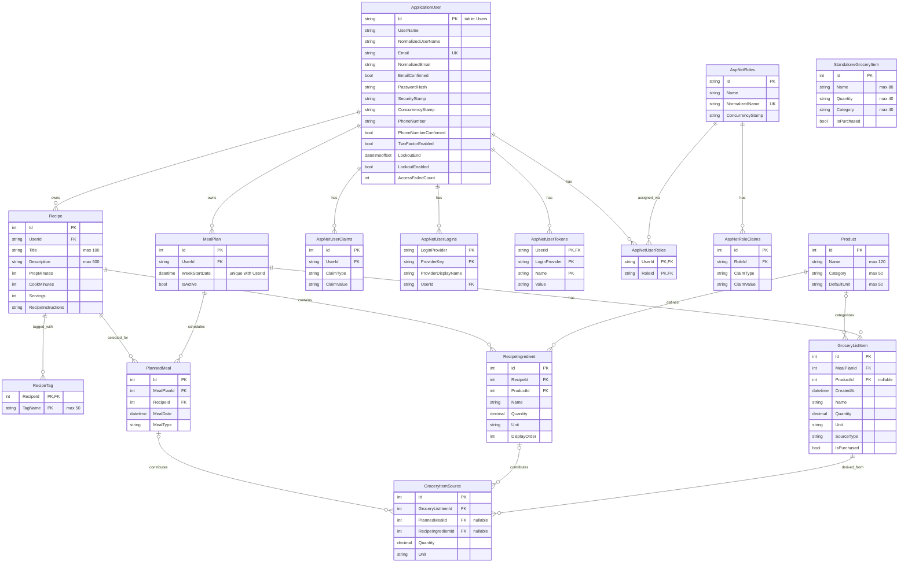

# Meal Planner ERD

Notes:

- Derived from `MealCraft/Migrations/MealCraftDbContextModelSnapshot.cs`.
- `ApplicationUser` maps to the `Users` table; the `Ingredient` model maps to the `RecipeIngredient` table.
- `StandaloneGroceryItem` has no relationships (not tied to a user or meal plan).
- Deleting a user cascades to their recipes and meal plans. Deleting a recipe cascades to its tags and ingredients. Deleting a meal plan cascades to its planned meals and grocery items.
- `PlannedMeal -> Recipe`, `RecipeIngredient -> Product`, and the `GroceryItemSource -> PlannedMeal/RecipeIngredient` links are `Restrict`. `GroceryListItem -> Product` is `SetNull`.
